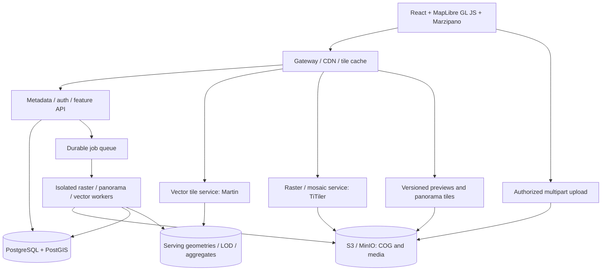

# Технический аудит Botplus Maps

Дата: 20 октября 2026 года. Проверенная локальная версия: `25eb8572126d2820eb04aeadf7c98c52ae447cfe`.

## 1. Заключение

Текущая реализация содержит полезную основу GIS-продукта, но её готовность к терабайтам ортофото, миллионам панорам и десяткам миллионов векторных объектов не подтверждена. В коде есть ошибки, которые уже сейчас увеличивают число запросов, отключают кэширование, расходуют память пропорционально размеру исходного файла и нарушают изоляцию операций. Простое увеличение числа Gunicorn workers или ресурсов сервера эти проблемы не устранит.

Рекомендуется сохранить PostGIS, S3-совместимое хранилище, концепцию COG и значительную часть React-интерфейса. Переработать нужно прежде всего пути доставки данных, управление слоями, подготовку производных данных, фоновые задачи и контроль доступа. Замена всего проекта с нуля создаст лишний риск; переход должен идти по компонентам с параллельной проверкой старого и нового отображения.

Требование «одновременно и без задержек» следует формализовать: все типы данных доступны и видимы совместно, но браузер загружает только нужные фрагменты текущего экрана и уровня детализации. Миллионы оригинальных фотографий и десятки миллионов подробных геометрий одновременно в памяти браузера — непригодный контракт. На обзорном масштабе нужны агрегаты, на подробном — тайлы и отдельные объекты по запросу. Первая загрузка всё равно зависит от сети; плавность перемещения можно обеспечить независимо от завершения сетевых запросов.

## 2. Объём и ограничения проверки

Проверены маршруты Flask, SQL генерации MVT и GeoJSON, код работы с панорамами, обработка GDAL/COG, S3, состояние и слои карты, компоненты загрузки и каталогов, аутентификация, Docker и миграции. Просмотрены 27 Python-файлов и основные TypeScript-модули приложения. Рекомендации по внешним технологиям сверены с официальной документацией.

Проверка опирается на локальную рабочую копию. Открыта также указанная пользователем [страница GitHub](https://github.com/Davud77/botplus_maps), но равенство локального HEAD последнему удалённому коммиту не установлено. Имеющиеся пользовательские изменения `.DS_Store` и `src/components/Home.tsx` не изменялись.

Результаты выполненных проверок:

| Проверка | Результат |
|---|---|
| `tsc --noEmit --incremental false` | Успешно |
| `CI=true BROWSERSLIST_IGNORE_OLD_DATA=true npm run build` | Ошибка: отсутствует `src/components/maps/MapPage.css`, импортированный из `MapPage.tsx:8` |
| Разбор AST всех 27 Python-файлов | Синтаксических ошибок нет |
| Изолированное выполнение `add_cors_headers` | `image/png: public, max-age=3600` превращается в `no-store`; MVT сохраняет кэширование; JavaScript также получает `no-store` |
| Изолированное выполнение `GdalService.get_bounds` на повёрнутом растре | Возвращает `south=north=0` вместо диапазона `[-100,100]` |
| Поиск отслеживаемых тестов, lock-файлов и CI | В проверенной версии не обнаружены |

Проверки функций выполнялись из исходного AST с подставными объектами ответа и растра; это воспроизведение логики, а не интеграционная проверка Flask/GDAL. Production, база с реальными объёмами, `EXPLAIN ANALYZE`, сетевой профиль и браузер под нагрузкой не проверялись. В локальном Python отсутствуют Flask, psycopg2 и minio; полноценный backend не запускался. Текущую пропускную способность, FPS и необходимое оборудование по этому аудиту нельзя честно выразить измеренными числами.

## 3. Подтверждённые проблемы

Приоритеты: **P0** — закрыть перед публичной эксплуатацией или масштабной загрузкой; **P1** — устранить для целевой нагрузки; **P2** — надёжность, сопровождение и качество продукта.

### F01. P0 — серверные операции не защищены авторизацией

**Доказательства:** [vector.py:77](https://github.com/Davud77/botplus_maps/blob/25eb8572126d2820eb04aeadf7c98c52ae447cfe/server/controllers/vector.py#L77), [ortho_controller.py:40](https://github.com/Davud77/botplus_maps/blob/25eb8572126d2820eb04aeadf7c98c52ae447cfe/server/controllers/ortho_controller.py#L40), [pano_controller.py:96](https://github.com/Davud77/botplus_maps/blob/25eb8572126d2820eb04aeadf7c98c52ae447cfe/server/controllers/pano_controller.py#L96). Проверка токена присутствует в `/api/auth/me`; общего middleware контроля доступа в `app.py` нет. Ограничения React-маршрутов находятся только на клиенте.

По коду доступ к загрузке, обработке, удалению, созданию БД и слоёв не требует сеанса. Доступность конкретного production-маршрута может дополнительно ограничиваться внешним proxy, конфигурация которого в репозитории не представлена. Возможность создания БД зависит от привилегий DB-role, но отсутствие серверной проверки прав подтверждено.

**Исправление:** централизованная проверка сеанса; отдельная проверка прав на проект, набор и операцию; административные действия убрать из публичного data API. Ввести `project_id`, владельца и права в модель данных. Для изоляции проектов использовать RLS либо эквивалентную последовательно проверяемую политику, отдельные роли БД для чтения тайлов и записи. Прямые tile endpoints тоже должны проверять доступ к закрытым данным.

### F02. P0 — запись пользовательского имени файла в произвольный путь

**Доказательства:** [ortho_controller.py:65](https://github.com/Davud77/botplus_maps/blob/25eb8572126d2820eb04aeadf7c98c52ae447cfe/server/controllers/ortho_controller.py#L65): `filename = file.filename`, затем `os.path.join(temp_dir, filename)` и `open(..., 'wb')` без проверки пути.

Специально сформированное имя может выйти за временную папку; одинаковые имена параллельных загрузок перезаписывают один файл. В Compose приложение дополнительно запускается как root, что расширяет последствия.

**Исправление:** серверный UUID для каталога загрузки и object key; исходное имя хранить только как метаданные. Проверять канонический путь внутри выделенной папки. Ввести квоты, контроль формата по содержимому, лимиты размеров/пикселей и изоляцию GDAL-обработки.

### F03. P0 — исходные файлы целиком читаются в RAM веб-сервера

**Доказательства:** [storage.py:145](https://github.com/Davud77/botplus_maps/blob/25eb8572126d2820eb04aeadf7c98c52ae447cfe/server/storage.py#L145): `io.BytesIO(response.read())`; этот путь используется и панорамами, и скачиванием ортофотопланов. [pano_controller.py:279](https://github.com/Davud77/botplus_maps/blob/25eb8572126d2820eb04aeadf7c98c52ae447cfe/server/controllers/pano_controller.py#L279): `file.read()` при загрузке.

Память на один запрос растёт как размер оригинала; число одновременно скачиваемых файлов умножает потребление. Дополнительные буферы могут увеличить пик. Большой TIFF способен исчерпать память процесса. Потоковое чтение upload на диск в другом обработчике не устраняет эту проблему при download.

**Исправление:** оригиналы отдавать через авторизованные S3 URL или выделенный streaming gateway с поддержкой Range и ограничениями. Основной просмотр должен получать тайлы/preview. Загрузку перенести на multipart напрямую в объектное хранилище с возобновлением и проверкой завершения.

### F04. P0 — общая DB connection для нескольких запросов и фоновых операций

**Доказательства:** [database.py:26](https://github.com/Davud77/botplus_maps/blob/25eb8572126d2820eb04aeadf7c98c52ae447cfe/server/database.py#L26), [pano_controller.py:29](https://github.com/Davud77/botplus_maps/blob/25eb8572126d2820eb04aeadf7c98c52ae447cfe/server/controllers/pano_controller.py#L29), [ortho_controller.py:20](https://github.com/Davud77/botplus_maps/blob/25eb8572126d2820eb04aeadf7c98c52ae447cfe/server/controllers/ortho_controller.py#L20), [ortho_service.py:158](https://github.com/Davud77/botplus_maps/blob/25eb8572126d2820eb04aeadf7c98c52ae447cfe/server/services/ortho_service.py#L158).

Контроллер создаётся один раз на процесс и хранит одну connection; фоновые задачи используют тот же manager/db. При `autocommit=False` читающие методы не завершают транзакции и не освобождают connection после запроса. Ошибка одного обработчика может откатить работу другого; commit может затронуть общую транзакцию. Длительная открытая транзакция мешает обслуживанию БД и, при transaction pooling, удерживает backend до завершения транзакции. Совместимость блокирующих DB-вызовов с выбранным gevent-режимом отдельно не проверена.

**Исправление:** отдельная транзакция на запрос/задачу, connection из ограниченного пула, обязательные rollback/close в `finally`, таймауты подключения и SQL. PgBouncer оставить внешним пулером, но не считать заменой правильному жизненному циклу транзакций. [Psycopg описывает](https://www.psycopg.org/docs/usage.html#thread-and-process-safety), что операции на одной connection разделяют сеанс и транзакцию.

### F05. P0 — HTML-инъекция в popup векторных объектов

**Доказательства:** [VectorTileLayer.tsx:98](https://github.com/Davud77/botplus_maps/blob/25eb8572126d2820eb04aeadf7c98c52ae447cfe/src/components/maps/layers/VectorTileLayer.tsx#L98). Имена полей, значения и имя слоя вставляются в HTML-строку `setContent` без экранирования.

При наличии в данных недоверенного HTML возможен stored XSS в origin приложения. HttpOnly-cookie не мешает вредоносному коду выполнять запросы от имени пользователя.

**Исправление:** DOM-узлы с `textContent` либо React-компонент с обычным текстовым выводом. Если HTML необходим — строгая санитаризация. Добавить CSP и тест с недоверенными атрибутами.

### F06. P0 — небезопасные настройки доступа и хранения секретов

**Доказательства:** [config.py:40](https://github.com/Davud77/botplus_maps/blob/25eb8572126d2820eb04aeadf7c98c52ae447cfe/server/config.py#L40), [init_pg_auth.py:58](https://github.com/Davud77/botplus_maps/blob/25eb8572126d2820eb04aeadf7c98c52ae447cfe/server/init_pg_auth.py#L58), [storage_service.py:23](https://github.com/Davud77/botplus_maps/blob/25eb8572126d2820eb04aeadf7c98c52ae447cfe/server/services/storage_service.py#L23), [pgbouncer.ini:9](https://github.com/Davud77/botplus_maps/blob/25eb8572126d2820eb04aeadf7c98c52ae447cfe/pgbouncer/pgbouncer.ini#L9).

В коде предусмотрены известные fallback-секреты и пароли; startup создаёт также обычного пользователя с известным паролем при отсутствии переменных. В отслеживаемом `pgbouncer/userlist.txt` есть значения в формате открытого пароля — их действительность не проверялась, значения в отчёте не раскрываются. Орто-бакету автоматически назначается public-read. В одной конфигурации PgBouncer указан `trust`.

Важное уточнение: показанный Compose не монтирует файлы `pgbouncer/` и задаёт `AUTH_TYPE=scram-sha-256`. Поэтому утверждать, что реально запущенный PgBouncer использует `trust`, нельзя. В репозитории присутствуют расходящиеся конфигурации.

**Исправление:** fail-fast при отсутствии production-секретов, убрать автоматическое создание стандартного пользователя, отозвать/заменить опубликованные учётные данные, если они использовались. Закрытые бакеты и минимальные роли. Явно разделить публичные и частные наборы, определить единственный источник конфигурации PgBouncer. Проверять CSRF/Origin для cookie-auth mutations, ограничить попытки входа; CORS не заменяет аутентификацию.

### F07. P1 — растровые тайлы и статические ресурсы получают `no-store`

**Доказательства:** [app.py:172](https://github.com/Davud77/botplus_maps/blob/25eb8572126d2820eb04aeadf7c98c52ae447cfe/server/app.py#L172), [ortho_controller.py:182](https://github.com/Davud77/botplus_maps/blob/25eb8572126d2820eb04aeadf7c98c52ae447cfe/server/controllers/ortho_controller.py#L182). Локальный обработчик ставит `public, max-age=3600`, после чего общий `after_request` заменяет заголовок на `no-store`, если MIME не MVT.

Повторный просмотр через Flask снова требует backend/renderer; правило применяется также к JS, CSS, preview и изображениям. Если production отдаёт frontend напрямую через другой сервер, влияние на статику зависит от этого маршрута. Ошибка для Flask-ответов воспроизведена изолированным запуском функции.

**Исправление:** отдельные политики для auth/metadata, версионированных тайлов, preview и статических файлов. Ключ кэша должен содержать dataset version и параметры рендера. Для private-данных публичное кэширование разрешать только после проверки доступа на edge и с правильной изоляцией.

### F08. P1 — один ортофотоплан создаёт два слоя Leaflet

**Доказательства:** [useMapStore.ts:99](https://github.com/Davud77/botplus_maps/blob/25eb8572126d2820eb04aeadf7c98c52ae447cfe/src/components/maps/hooks/useMapStore.ts#L99) создаёт `L.tileLayer` и добавляет его на карту; [OrthoLayer.tsx:20](https://github.com/Davud77/botplus_maps/blob/25eb8572126d2820eb04aeadf7c98c52ae447cfe/src/components/maps/layers/OrthoLayer.tsx#L20) по тому же `selectedOrthoIds` создаёт React `TileLayer`. Оба подключены в текущем MapPage.

Это два экземпляра слоя с самостоятельным жизненным циклом и потенциально повторной загрузкой/декодированием тайлов; точное число HTTP-запросов зависит от браузерного объединения запросов и кэша. При `no-store` проблема усиливается.

**Исправление:** один владелец жизненного цикла слоя. В Zustand хранить ID и настройки; создавать и удалять экземпляры карты в одном адаптере.

### F09. P1 — число растровых запросов растёт с числом выбранных снимков

**Доказательства:** [OrthoLayer.tsx:20](https://github.com/Davud77/botplus_maps/blob/25eb8572126d2820eb04aeadf7c98c52ae447cfe/src/components/maps/layers/OrthoLayer.tsx#L20): отдельный TileLayer на каждый ID; `bounds` не передан. [ortho_service.py:361](https://github.com/Davud77/botplus_maps/blob/25eb8572126d2820eb04aeadf7c98c52ae447cfe/server/services/ortho_service.py#L361): на каждый tile-запрос поиск метаданных в БД и HTTP-запрос в TiTiler.

Нет маршрутизации по пространственному каталогу и выбора снимков по покрытию/дате/приоритету. Запросы уходят и для областей вне снимка. Несколько полностью непрозрачных перекрывающихся слоёв загружаются, хотя пользователь видит верхний.

**Исправление:** логический raster collection/mosaic source, spatial index footprint, отбор кандидатов на сервере, заданные правила перекрытия и времени. Использовать ограниченное число визуальных raster sources, spatial bounds, min/max zoom. Для сравнения дат — два mosaic source и swipe/opacity. Непрозрачные перекрывающиеся изображения нельзя одновременно различить без такого интерфейса.

### F10. P1 — ошибки TiTiler маскируются успешным прозрачным тайлом

**Доказательства:** [ortho_service.py:374](https://github.com/Davud77/botplus_maps/blob/25eb8572126d2820eb04aeadf7c98c52ae447cfe/server/services/ortho_service.py#L374). Любой non-200/exception превращается в прозрачный PNG; controller отдаёт его как обычный успех. `rescale=0,255` задан для всех наборов.

Пользователь видит отсутствие данных вместо сбоя. После исправления кэша без исправления этой ошибки можно начать кэшировать сбои как пустые участки. Универсальный rescale некорректен для части 16-bit/float/многоканальных растров.

**Исправление:** отличать валидный empty tile от 5xx/timeout/нет доступа; короткий либо нулевой negative cache для временных сбоев; метрики и request ID. Хранить render profile: band selection, nodata/mask, dtype, stretch и format. Ключ кэша включает render profile/version.

### F11. P1 — тяжёлые задачи живут внутри Gunicorn

**Доказательства:** [ortho_service.py:158](https://github.com/Davud77/botplus_maps/blob/25eb8572126d2820eb04aeadf7c98c52ae447cfe/server/services/ortho_service.py#L158), [task_service.py:17](https://github.com/Davud77/botplus_maps/blob/25eb8572126d2820eb04aeadf7c98c52ae447cfe/server/services/task_service.py#L17), `docker-compose.yml`: gevent, четыре workers, timeout 36000 секунд.

На каждый запуск создаётся новый `threading.Thread`; нет долговечной очереди, централизованного ограничения параллелизма, retry/lease, восстановления после рестарта и идемпотентности. JSON-файл состояния не является механизмом исполнения. Несколько GDAL-задач с `ALL_CPUS` конкурируют за CPU, RAM, scratch и диск с показом карты. Большой HTTP timeout не устраняет эту конкуренцию.

**Исправление:** отдельные worker-процессы/контейнеры и долговечная очередь, например Celery + RabbitMQ; состояния и попытки в PostgreSQL. Ограничения CPU/RAM/scratch на задачу, отдельные очереди raster/panorama, повторное исполнение без дублирования результата, heartbeat, отмена и сборка мусора. CPU-задачи не должны выполняться в процессе API.

### F12. P1 — публикация COG не является обязательной стадией

**Доказательства:** [ortho_service.py:87](https://github.com/Davud77/botplus_maps/blob/25eb8572126d2820eb04aeadf7c98c52ae447cfe/server/services/ortho_service.py#L87): upload только проверяет COG и сохраняет исходник; конвертация запускается отдельно. [ortho_service.py:183](https://github.com/Davud77/botplus_maps/blob/25eb8572126d2820eb04aeadf7c98c52ae447cfe/server/services/ortho_service.py#L183) и `:258`: `COMPRESS=NONE`, `ALL_CPUS`; полное скачивание исходника перед обработкой.

Неоптимизированный TIFF может попасть в отображение. Несжатая производная увеличивает storage и чтение блоков; иногда она оправдана CPU-бюджетом, но универсально выбирать её нельзя. Для больших файлов нужны исходник, выход, временные overviews и резерв scratch; фиксированный универсальный коэффициент без измерений неверен.

**Исправление:** pipeline `uploaded → validating → processing → ready → published`; показывать только готовую проверенную версию. Для RGB-ортофото отдельно оценить JPEG/WEBP с допустимой потерей качества; для аналитических данных — lossless DEFLATE/ZSTD и подходящий predictor. Проверять совместимость кодеков установленного GDAL, overviews, block size, nodata и Range-чтение. `OVERVIEWS=IGNORE_EXISTING` не означает отсутствия overviews: COG driver умеет строить их сам. [GDAL COG](https://gdal.org/en/stable/drivers/raster/cog.html) документирует эти параметры и временные затраты диска. Тотальная перепроекция всех исходников в 3857 не обязательна: решение принимается по стоимости динамического warp и профилю показов.

### F13. P1 — геопривязка обрабатывается с ошибками и эвристиками

**Доказательства:** [gdal_service.py:57](https://github.com/Davud77/botplus_maps/blob/25eb8572126d2820eb04aeadf7c98c52ae447cfe/server/services/gdal_service.py#L57): bounds из двух противоположных углов; `get_footprint_wkt` не учитывает коэффициенты rotation; `get_crs` опознаёт локальную CRS по фрагменту строки. [useMapStore.ts:126](https://github.com/Davud77/botplus_maps/blob/25eb8572126d2820eb04aeadf7c98c52ae447cfe/src/components/maps/hooks/useMapStore.ts#L126) считает всё, что не распознано как 3857, широтой/долготой.

На тестовом geotransform `(0,1,1,0,1,-1)` для изображения 100×100 код возвращает нулевую высоту bounds. Для локальных проекций и повёрнутых снимков пользователь может получать неверную область; transformed footprint только по углам также может недооценивать искривлённую границу.

**Исправление:** хранить полноценную CRS WKT/PROJJSON и идентификатор, все четыре affine-угла, при необходимости уплотнять границу перед transform, явно согласовать axis order. Сервер отдаёт нормализованный footprint/bbox EPSG:4326 отдельно от native bounds. Проверки на MSK, 4326/3857, rotation, nodata и реальные контрольные точки; точность преобразования локальной системы требует известной корректной операции и её параметров.

### F14. P1 — MVT рассчитываются на каждом запросе по исходной геометрии

**Доказательства:** [vector.py:268](https://github.com/Davud77/botplus_maps/blob/25eb8572126d2820eb04aeadf7c98c52ae447cfe/server/controllers/vector.py#L268), `:301`, `:359`, `:404`: запросы метаданных на каждый tile, выбор всех негеометрических столбцов, `ST_Transform(ST_Force2D(...),3857)` для найденных объектов; отсутствуют подготовленные zoom-зависимые представления.

Положительный момент: bbox-фильтр трансформирует envelope в CRS источника, а не оборачивает индексируемый исходный столбец в `ST_Transform`. Это сохраняет возможность использования исходного spatial index. Однако на обзорном масштабе bbox захватывает огромную область: один GiST не ограничивает стоимость агрегации и обработки всех попавших объектов. `ST_AsMVTGeom` уже выполняет clipping/квантование; утверждать, что clipping отсутствует, неверно.

**Исправление:** отдельная serving geometry 3857 с GiST, подготовленные уровни детализации, минимальные атрибуты для стилизации/идентификации, кэш метаданных; большие геометрии по необходимости subdivide с сохранением исходного ID. Для низких zoom — заранее подготовленные обобщения/агрегаты, для высоких — подробные тайлы. Статичные слои — предгенерированные архивы; изменяемые — контролируемые SQL tile functions через специализированный tile server. Общий размер таблицы вторичен относительно числа вершин и объектов, обработанных на один экран.

### F15. P1 — MVT buffer не согласован с bbox отбора

**Доказательства:** [vector.py:307](https://github.com/Davud77/botplus_maps/blob/25eb8572126d2820eb04aeadf7c98c52ae447cfe/server/controllers/vector.py#L307): `ST_AsMVTGeom` использует стандартный buffer, а WHERE — точные границы тайла без margin. То же в combined endpoint.

Объекты непосредственно за границей тайла не попадут в buffer. Это может давать артефакты широких линий/символов на стыках.

**Исправление:** явно задавать extent/buffer и расширять bbox на `buffer/extent`, сохраняя исходные границы для clipping. Пример соответствующего запроса есть в [PostGIS ST_AsMVTGeom](https://postgis.net/docs/ST_AsMVTGeom.html). Проверять стыки при разных DPR и стилях, а не только наличие ответа PBF.

### F16. P1 — произвольные combined-наборы ухудшают переиспользование тайлов

**Доказательства:** [VectorLayerRenderer.tsx:118](https://github.com/Davud77/botplus_maps/blob/25eb8572126d2820eb04aeadf7c98c52ae447cfe/src/components/maps/layers/VectorLayerRenderer.tsx#L118): URL зависит от списка всех включённых таблиц; React key тоже включает список. [vector.py:389](https://github.com/Davud77/botplus_maps/blob/25eb8572126d2820eb04aeadf7c98c52ae447cfe/server/controllers/vector.py#L389): все подзапросы объединяются в один SQL.

Включение ещё одного слоя пересоздаёт источник и меняет URL ранее загруженных комбинаций. Разные порядки одних таблиц создают разные cache keys; количество возможных подмножеств растёт как `2^N`. Медленный слой задерживает весь ответ. Само объединение MVT допустимо и иногда полезно, проблема — произвольная пользовательская комбинация на критическом пути.

**Исправление:** фиксированные тематические tilesets с согласованным графиком обновления или независимые стабильные источники. Скрытие слоя — изменение visibility. Если комбинации нужны, canonical sorting, allowlist, лимит состава и общий deadline.

### F17. P1 — перед MVT дополнительно загружается GeoJSON

**Доказательства:** [useVectorStore.ts:45](https://github.com/Davud77/botplus_maps/blob/25eb8572126d2820eb04aeadf7c98c52ae447cfe/src/components/maps/hooks/useVectorStore.ts#L45), [vector.py:220](https://github.com/Davud77/botplus_maps/blob/25eb8572126d2820eb04aeadf7c98c52ae447cfe/server/controllers/vector.py#L220). Активация слоя сначала получает GeoJSON без bbox, до 5000 объектов по умолчанию, делает `ST_MakeValid`/simplify, сохраняет данные в Map; сам renderer использует MVT.

Это лишняя серверная работа и память перед первым показом. Наборы остаются в `loadedVectors` после выключения. Значения state захватываются до `await`: параллельные активации могут перезаписывать результаты друг друга. GeoJSON endpoint не переводит геометрию из native SRID в 4326, поэтому для источника в метрах ответ не соответствует ожидаемым координатам GeoJSON.

**Исправление:** активация по каталогу/TileJSON, данные — только тайлами. Полную геометрию и атрибуты получать по ID выбранного объекта отдельным API. GeoJSON оставить для небольшого редактируемого выделения; нормализовать CRS и ввести жёсткие серверные лимиты. Использовать функциональные обновления state и убрать неограниченный кэш исходных объектов.

### F18. P1 — рендер векторов пересоздаётся при обычных React-обновлениях

**Доказательства:** [VectorLayerRenderer.tsx:123](https://github.com/Davud77/botplus_maps/blob/25eb8572126d2820eb04aeadf7c98c52ae447cfe/src/components/maps/layers/VectorLayerRenderer.tsx#L123) каждый render создаёт новый объект конфигураций; [VectorTileLayer.tsx:127](https://github.com/Davud77/botplus_maps/blob/25eb8572126d2820eb04aeadf7c98c52ae447cfe/src/components/maps/layers/VectorTileLayer.tsx#L127) эффект зависит от этого объекта, удаляет и создаёт слой. Категорийный стиль ищется через `rules.find` для каждого объекта.

Дополнительно конфигурации стиля кэшируются только по `tableName`, из-за чего одноимённые таблицы разных схем/БД могут получать чужой стиль; fallback ID `0` объединяет объекты без корректного ID. `SetMapRef` объявлен внутри MapPage и перемонтируется при render родителя.

**Исправление:** стабильный адаптер карты, отдельное обновление style/visibility без пересоздания источника, selectors Zustand и стабильные props. Ключи каталога — устойчивые dataset ID вместо разбора строк с дефисами. На текущем Leaflet коде минимум — memoization, Map для категорий, корректные feature ID; при замене движка — MapLibre expressions и `feature-state`.

### F19. P1 — панорамные точки агрегируются заново по движению карты

**Доказательства:** [pano_controller.py:120](https://github.com/Davud77/botplus_maps/blob/25eb8572126d2820eb04aeadf7c98c52ae447cfe/server/controllers/pano_controller.py#L120): `GROUP BY ST_SnapToGrid` по всем попавшим в bbox точкам, затем LIMIT. [PanoLayer.tsx:25](https://github.com/Davud77/botplus_maps/blob/25eb8572126d2820eb04aeadf7c98c52ae447cfe/src/components/maps/layers/PanoLayer.tsx#L25): лимит 50000 и React-компонент для каждой возвращённой точки/кластера.

Уже есть полезные bbox, GiST, debounce и AbortController. Однако LIMIT после GROUP BY не гарантирует дешёвый расчёт: все соответствующие точки могут потребовать чтения и агрегации. Ячейки заданы в градусах и меняют экранный размер с широтой. Агрегаты меняются при пересечении границей viewport; нет нормализованного tile cache. Кластеры создаются DOM-marker, raw-точки — отдельными Leaflet/React объектами. Canvas не устраняет эти расходы и сам по себе не гарантирует GPU-ускорение.

**Исправление:** панорамный spatial tileset, подготовленные агрегаты по уровням, MVT и GPU circle/symbol layers. Агрегация по сетке в координатах отображения либо по выбранной пространственной иерархии с понятной семантикой. По клику — zoom/expansion или cursor-list совпадающих съёмок. Жёсткие ограничения bbox/zoom/limit на сервере, корректная обработка dateline и полюсов. Отмена fetch в браузере сама по себе не гарантирует отмены уже выполняющегося SQL.

### F20. P1 — просмотр панорамы требует полный оригинал

**Доказательства:** [PanoramaViewer.tsx:66](https://github.com/Davud77/botplus_maps/blob/25eb8572126d2820eb04aeadf7c98c52ae447cfe/src/components/maps/ui/viewers/PanoramaViewer.tsx#L66): `fetch → blob → objectURL`, один уровень `EquirectGeometry([{width:4000}])`. Cleanup обнуляет ref, но не вызывает `viewer.destroy()`; загрузка не отменяется AbortController.

Первый кадр ждёт полного скачивания. Панорама 16000×8000 после декодирования в RGBA требует около 488 MiB только для одного изображения; текстуры и дополнительные копии увеличивают расход. Это оценка формата, а не измерение текущих файлов. При смене панорам возможны утечки ресурсов viewer и избыточные загрузки.

**Исправление:** сохранить Marzipano, но заранее строить multiresolution cube tiles, low-res preview и manifest. Один viewer с переиспользованием/уничтожением сцен; строгий lifecycle, отмена устаревших запросов, ограниченный prefetch соседей. [Marzipano CubeGeometry](https://www.marzipano.net/reference/CubeGeometry.html) поддерживает несколько уровней tiled cube; [Viewer](https://www.marzipano.net/reference/Viewer.html) имеет destroy lifecycle. Для обычных фото — thumbnail/preview, для сверхбольших — отдельная пирамида; классифицировать тип media, а не считать любой JPEG с GPS сферической панорамой.

### F21. P1 — нет надёжной версии и согласованной публикации данных

**Доказательства:** object keys формируются из пользовательских имён, новые COG создаются как дополнительные записи, upload записывает объект перед БД, delete в разных ветках имеет разный порядок удаления БД/S3. `StorageService.upload_file()` может вернуть `False`, который вызывающий код не проверяет. Derived-записи могут делить один `preview_filename`, который удаляется вместе с одной из записей.

Возможны сироты в S3, записи без файла, коллизии имён, удаление разделяемого preview. MVT сейчас отдаётся с TTL 86400 по URL без версии — при изменении данных клиент может видеть устаревшую карту. Мутация `self.minio.bucket_name` перед операцией создаёт дополнительное разделяемое состояние и плохо переносит конкурентное выполнение/исключения.

**Исправление:** immutable object keys `project/dataset/version/asset`, manifest и атомарное переключение published version в БД после проверки всех артефактов. Transactional outbox для дальнейших действий, идемпотентные операции, soft-delete/tombstone и периодическая сверка DB/S3. Bucket/key передавать аргументами, не менять общие поля клиента. Удалять артефакты после проверки ссылок и периода удержания.

### F22. P1 — каталоги грузятся целиком, фильтруются и выводятся на клиенте

**Доказательства:** [ortho_manager.py:90](https://github.com/Davud77/botplus_maps/blob/25eb8572126d2820eb04aeadf7c98c52ae447cfe/server/managers/ortho_manager.py#L90), [OrthoPanel.tsx:60](https://github.com/Davud77/botplus_maps/blob/25eb8572126d2820eb04aeadf7c98c52ae447cfe/src/components/maps/ui/panels/OrthoPanel.tsx#L60), [ProfilePanoramas.tsx:35](https://github.com/Davud77/botplus_maps/blob/25eb8572126d2820eb04aeadf7c98c52ae447cfe/src/components/profile/ProfilePanoramas.tsx#L35).

Орто-каталог не имеет серверной пагинации/bbox; spatial index footprint в показанной миграции не создаётся. Панорамный личный кабинет вызывает карту-маркеры вместо API каталога: получает `lat/lng/count`, хотя ожидает filename/latitude/longitude/date, и может строить до 50000 строк таблицы. Редактирование тегов в backend отвечает 501.

**Исправление:** разделить `/catalog`, `/tiles`, `/media/{id}`, `/features/{id}`. Каталог — keyset/cursor pagination с устойчивой сортировкой, фильтры проекта/времени/bbox, ограниченные page size; виртуализация списков и lazy preview. `is_visible` трактовать как состояние публикации, а доступ — отдельной политикой.

### F23. P1 — текущая production-сборка не проходит

**Доказательство:** выполненная сборка останавливается на отсутствующем `MapPage.css`, импорт `src/components/maps/MapPage.tsx:8`. TypeScript при этом проходит: проверка типов не доказывает успешную упаковку CSS и runtime-ассетов.

**Исправление:** восстановить/исправить импорт стилей, затем повторить полную production-сборку и smoke-test страницы карты. Ошибка не исправлялась в рамках аудита, чтобы не подменять анализ несогласованной переработкой интерфейса.

### F24. P2 — окружение невоспроизводимо, конфигурации расходятся

**Доказательства:** `package.json`: `react-router-dom: latest`, отсутствует отслеживаемый lock-файл, `@types/react-router-dom` пятой версии при использовании API нового роутера. Python requirements задают только нижние границы. В Compose есть `latest`/нефиксированные образы; Dockerfile доустанавливает Babel-плагин и обновляет Browserslist во время сборки. `.dockerignore` в проверенной версии не обнаружен.

`vector.py` собирает DSN по DB_* и не использует основной DATABASE_URL; Compose явно передаёт DATABASE_URL, но не DB_HOST/DB_PORT/DB_USER/DB_PASSWORD в app. Пользовательский хост/роль в основном URL поэтому не обязательно применятся к vector API. Frontend смешивает относительные URL и захардкоженный localhost:5580. Неиспользуемый RegisterPage обращается на отдельный hardcoded endpoint.

**Исправление:** lock-файлы, проверенные версии и image digests, единая валидируемая settings-модель и API origin, воспроизводимая сборка в CI. `.dockerignore` исключает node_modules, .git, локальные данные и секреты из build context. Миграцию CRA → Vite проводить после восстановления сборки; она улучшит разработку, но сама по себе не ускорит карту.

### F25. P2 — миграции и startup не гарантируют корректное состояние

**Доказательства:** миграция Alembic содержит `down_revision='previous_revision'`, конфигурация полноценной цепочки не представлена, Alembic нет в requirements. Она индексирует старую таблицу `panoramas`, а текущий controller использует `photos_4326`. `init_pg_auth.py` создаёт `ortholist`, а manager работает с `orthophotos`; ALTER/CREATE выполняются при импорте/старте каждого worker.

`app.py` перехватывает ошибки импорта целых blueprint и продолжает работу; `/api/health` всегда сообщает `ok`, не проверяя зависимости. `init_pg_auth.py` печатает ошибку без обязательного nonzero exit, так что `set -e` entrypoint не гарантирует остановку.

**Исправление:** одна настоящая цепочка миграций отдельным release-job, никаких DDL при запросах/импорте. Не стартовать с пропавшими обязательными маршрутами. Разделить liveness/readiness; readiness подтверждает нужную схему и зависимости. Убрать неиспользуемый FastAPI-черновик `server/app/routers/panoramas.py`, у которого отсутствуют часть зависимостей/модулей, либо явно отделить его от работающего Flask-приложения.

### F26. P2 — эксплуатация не описана для потери узла и роста нагрузки

**Доказательства:** в Compose одиночные DB/MinIO, app `user: root`, опубликованные host-порты DB, PgBouncer, MinIO console и TiTiler; отсутствует описанный backup/PITR/restore workflow, мониторинг и нагрузочный CI. Host port без IP по умолчанию публикуется на всех интерфейсах; фактическая доступность зависит от firewall/хостинга. Наличие published ports не доказывает внешнюю доступность production.

**Исправление:** доступ извне только через gateway, внутренние сети и ограниченные роли; непривилегированные контейнеры и resource limits. PostgreSQL backup+WAL/PITR, резервирование объектов вне исходного узла, проверяемое восстановление. Replication и erasure coding не заменяют backup от ошибочного удаления. Метрики tail latency, DB query time, queue age, cache hit, bytes/read tile, память worker и GPU-контекстов клиента.

## 4. Целевая архитектура

Это логические контуры, которые не обязательно превращать в десятки микросервисов. Для старта достаточно модульного API, готовых tile-сервисов и отдельных workers. API управления и media/tile traffic должны масштабироваться независимо.

### Карта и frontend

Основной кандидат — **MapLibre GL JS**: vector tiles, WebGL, стили без React-объекта на каждую геометрию. [Официальное руководство](https://maplibre.org/maplibre-gl-js/docs/guides/large-data/) рекомендует tiles, уменьшение атрибутов, clustering и zoom-зависимую детализацию для больших наборов. Это архитектурный выбор, а не обещание конкретного ускорения: итог зависит от вершин, labels, слоёв, GPU и данных.

React отвечает за панели и выбор, один MapController — за sources/layers; серверные данные не копируются целиком в Zustand. Tile sources стабильны, visibility/style меняются отдельно. Детальная карточка загружается по ID. Маркеры массовых наборов рисуются GPU-слоями; DOM-маркеры остаются для нескольких выбранных объектов. Map и panorama viewer делят бюджет GPU/памяти: при открытии панорамы сократить prefetch/детальность миникарты, при закрытии освободить лишние ресурсы.

Если редактирование в специфических локальных CRS окажется ключевой функцией, отдельно сравнить OpenLayers с WebGL на ваших сценариях. Для текущей основной задачи показа MVT/raster tiles начинать с MapLibre. deck.gl подключать только при доказанной необходимости специальных плотных/3D-визуализаций.

### Векторы

Разделить canonical tables для точных исходных данных и serving tables для отображения. Serving: 2D 3857, GiST, подготовленные zoom bands, небольшое число свойств, стабильный `feature_id`. Массивные полигоны при необходимости разбить и связать с original ID; `ST_Subdivide` может улучшать селективность пространственного поиска, что описано в [PostGIS](https://postgis.net/docs/ST_Subdivide.html). Границы соседних полигонов должны оставаться согласованными: независимое упрощение каждого полигона может создать щели.

На низких zoom показывать класс/плотность/генерализованную сеть, на больших — исходную подробность. Настройки LOD зависят от смысла слоя: кадастровые участки, инженерные линии и обзорная дорожная сеть требуют разных правил. Нельзя молча обрезать точные результаты случайным LIMIT: сообщать режим агрегации/неполноты и давать доступ к полному объекту.

Для изменяемых слоёв — **Martin + PostGIS functions** с фиксированными контрактами и allowlist; автоматическую публикацию всех таблиц отключить/ограничить. [Martin](https://maplibre.org/martin/) поддерживает PostGIS и архивы тайлов. Производительность SQL остаётся нашей ответственностью. Для редко меняющихся слоёв — versioned PMTiles в S3/CDN, обновление отдельными наборами/регионами по разумному размеру. [PMTiles](https://docs.protomaps.com/pmtiles/) читает нужные фрагменты через HTTP Range, но архив не обновляется транзакционно на месте; произвольные private-фильтры требуют иной схемы доступа/сервинга.

### Ортофотопланы

Оригинал сохраняется неизменным. Публикуемая COG-производная проходит проверку структуры, overviews и нескольких контрольных tile reads. Каталог хранит footprint, native CRS, WGS84 bbox, разрешение, dtype, bands, nodata, время съёмки, checksum, версию и render profile.

Один логический mosaic endpoint выбирает COG по tile bbox и правилам проекта. При большом каталоге нужен индексированный поиск кандидатов и ограничение fan-out на один tile; чтение сотен мелких COG ради одного overview тайла следует заменять overview mosaic/подготовленным продуктом. Для востребованных статичных областей/масштабов заранее готовить display tiles, для остальных — TiTiler с кэшем. Не нужно генерировать все возможные уровни до z24 для всего архива.

Вынести raster traffic из общего Flask-процесса, кэшировать метаданные manifest и готовые тайлы. COG/Range — сокращение прочитанных байтов, CDN/tile cache — сокращение повторного рендеринга; это разные уровни оптимизации. Настройки GDAL и TiTiler подбирать по числу Range-запросов, прочитанным байтам, памяти и конкуренции, ориентируясь на [TiTiler performance tuning](https://developmentseed.org/titiler/advanced/performance_tuning/).

### Панорамы и фотографии

Разделить географический каталог media и контент. Каталог точек — PostGIS/MVT/агрегаты. Контент — original + thumbnail + preview + pyramid/manifest. Для миллионов панорам важны object count и request overhead: число панорам × шесть граней × число уровней × тайлы. Перед массовой генерацией измерить это на репрезентативной выборке; выбор tile size/packing зависит от storage и CDN. Отдельный объект на каждый tile проще, но не всегда экономичнее.

Первые preview получают приоритет выше полного качества. Далее загружаются видимые грани текущего FOV и только небольшой набор соседей. Навигация по треку хранится отдельной сущностью, а не определяется бесконечным поиском среди миллионов media. Совпадающие координаты, разные даты и этажи обрабатываются через список/фильтры. Для фото без полного сферического покрытия не применять equirectangular viewer автоматически.

### API, данные и безопасность

Ввести сущности `projects`, `datasets`, `dataset_versions`, `assets`, `media`, `jobs`, `permissions`. Версии набора и алгоритма подготовки — часть происхождения артефакта. Избавиться от независимых latitude/longitude VARCHAR как главного источника координат; держать типизированную геометрию и согласованные derived-поля. DB primary key и timestamp — не замена checksum исходного файла.

API выдаёт каталог, права, TileJSON/manifests и карточки объектов. Браузер не выбирает произвольные DB/schema/table из URL. Внешний ID слоя отображается сервером на разрешённый источник. Для cookie auth нужны реальные серверные проверки, CSRF-защита и понятное время жизни/отзыв сеансов. Можно оставить Flask и SQLAlchemy с корректными scopes; переход на FastAPI не обязателен для масштабирования и не ускорит тяжёлый SQL/GDAL.

Ключ тайла: `dataset/version/tileset/z/x/y/render-profile/filter-scope`. Геометрия и стиль версионируются отдельно, если стиль клиентский. Для закрытых данных авторизация выполняется до cache hit; одного включения tenant ID в URL недостаточно. Предотвращать cache stampede и вводить per-user/project quotas. В публичный TiTiler не передавать произвольный пользовательский `url`: ограничить разрешённые storage sources.

## 5. Нагрузка: что измерять и какие цели поставить

Объём архива сам по себе не определяет число серверов. Нужны: активные пользователи, число одновременно видимых источников, плотность данных на разных zoom, размер/вершины геометрии, размер панорам, частота обновления, доля cold cache, география сети и классы устройств.

Упрощённая модель tile traffic:

`R ≈ U × F × T × S`, где U — активные пользователи, F — число обновлений покрытия в секунду, T — число новых tile positions за обновление, S — число независимых источников. Для raster fan-out S особенно заметен. Запросы к origin приблизительно `R × (1 − cache_hit)`, но origin miss может породить несколько DB/S3 операций.

Иллюстрация, **не замер проекта**: 200 пользователей × 0,2 обновления/с × 20 новых тайлов × 3 источника = 2400 tile requests/с. При 95% cache hit остаётся примерно 120 misses/с. При среднем ответе 100 KiB это около 234 MiB/с клиентского трафика; рендеринг на origin и полоса edge — разные бюджеты. Холодная география и private-фильтры способны резко снизить hit rate.

Предлагаемые стартовые критерии для согласованного профиля desktop/network, **не текущие результаты и не универсальная гарантия**:

| Метрика | Начальная цель |
|---|---|
| Плавность при совместной карте и панораме | 50–60 FPS на оговорённом desktop; отдельно цели для мобильных |
| Warm-cache tile latency с учётом сети, p95 | до 200 мс в согласованном регионе |
| Cold-cache tile latency, p95 | до 0,5–1,5 с по классу tile; тяжёлые сценарии выделить |
| Первый полезный вид карты, p95 | до 2 с на согласованном сетевом профиле |
| Первый preview панорамы, p95 | до 1 с; улучшение качества прогрессивно |
| Cursor-страница каталога, p95 | до 300 мс без загрузки контента |
| Ошибки сервиса под целевой нагрузкой | менее 0,1% для согласованного профиля, отдельно учитывать client cancellation |
| Память после длительной навигации | стабильное плато, без роста с числом просмотренных объектов |

Бюджет MVT/растрового tile, число объектов и вершин на экран установить по прототипу; нельзя назначить их только по числу строк БД. Собирать p50/p95/p99, throughput, таймауты, GPU memory/context loss, main-thread long tasks, JS heap и bytes transferred. Отдельно время API, SQL, object storage, renderer и очередь — один общий timer не объяснит причины задержки.

Нагрузочная программа:

1. Ступени данных: 1/10/50 млн векторных объектов; 0,1/1/5 млн media points; сотни ГБ и затем репрезентативный терабайтный raster-каталог. Для векторов фиксировать также число вершин и размеры TOAST/индексов.
2. Сценарии: dense city, обзор всей территории, крупный сложный полигон, много пересекающихся снимков, быстрое pan/zoom, смена дат/фильтров, 100 последовательных панорам, медленная сеть.
3. Профили cold/warm cache; shared public и private data; заданные browser/DPR/GPU. Проверить смесь чтения карты и одновременного ingestion — изолированное чтение не показывает конкуренцию.
4. Ступени пользователей 1/10/50/200 и далее до целевого значения. Нагрузчик HTTP не заменяет браузерный benchmark FPS и памяти. При генерации запросов не использовать одну и ту же область, если реальные пользователи распределены по разным территориям.
5. `EXPLAIN (ANALYZE, BUFFERS)` безопасно на staging: планы GiST/seq scan, число прочитанных объектов, CPU/IO, степень обобщения. Seq scan на мировом bbox может быть корректным планом, но serving design должен избегать такой дорогой операции на каждый запрос.
6. Soak-тест, рестарт worker, потеря job lease, недоступность S3, timeout TiTiler, переполнение scratch, восстановление backup. Проверять отсутствие потери/дублирования данных и смешивания прав в кэше.

## 6. План переработки

Оценки ниже — ориентир для одного опытного full-time инженера при доступных данных и окружении. Они не включают неизвестные требования редактирования, enterprise IAM, закупку инфраструктуры и полный backfill многотерабайтного архива. Реальный срок подтвердится после первого прототипа.

| Этап | Работы | Критерий завершения | Ориентир |
|---|---|---|---|
| 0. Стабилизация | Восстановить build; закрыть mutation API; исправить пути upload, shared DB transaction, HTML popup, секреты | Build проходит; negative auth tests; изоляция транзакций; безопасная загрузка | 1–2 недели |
| 1. Быстрые исправления показа | Убрать duplicate ortho layer, `no-store`, GeoJSON prefetch, пересоздание vector source; исправить viewer cleanup и errors | Меньше лишних запросов; корректные cache/error semantics; baseline trace | 1–2 недели |
| 2. Версии и ingestion | Multipart, durable jobs, isolated workers, COG validation, media pyramids, publish manifest | Resume/retry/restart не теряют данные; ready/published согласованы | 2–4 недели |
| 3. Новый tile path | MapLibre prototype, Martin, serving geometry/LOD, raster mosaic, edge cache | Один тяжёлый эталонный набор соответствует согласованному бюджету | 3–5 недель |
| 4. Каталог и эксплуатация | Cursor API, права проектов, индексы, UI virtualization, backups, metrics, нагрузка | Mixed workload и restore tests проходят | 2–4 недели |
| 5. Перенос | Backfill версиями, сравнение покрытия/атрибутов/CRS, canary и rollback | Нет потери оригиналов/ID/прав; новый путь принят | По объёму и скорости обработки |

Часть работ может перекрываться при наличии команды. Нельзя обещать миграцию всех исходников за время переписывания интерфейса: backfill ограничивается сетью, storage throughput и CPU-кодеками.

Порядок безопасного внедрения: сначала исправления и наблюдаемость, затем один end-to-end вертикальный срез (орто + MVT + панорама на одном экране), затем масштабирование и массовая подготовка. Новый путь включать по feature flag для выбранных проектов; переключение опубликованной версии должно позволять быстрый rollback.

## 7. Что сохранить и что заменить

| Компонент | Решение |
|---|---|
| PostgreSQL/PostGIS | Сохранить; разделить canonical/serving, исправить scopes, миграции и индексы |
| S3-совместимое хранилище | Сохранить интерфейс; проверить надёжность выбранного deployment и модель private/public |
| TiTiler/GDAL | Сохранить; вынести из API, обеспечить проверенные COG, mosaic routing и cache |
| React и большая часть панелей | Сохранить, исправить контракты и виртуализацию |
| Zustand | Сохранить для UI/выбора; убрать bulk geometry и дублирующее владение картой |
| Leaflet как основной движок тяжёлой карты | Поэтапно заменить на MapLibre после эталонного benchmark |
| Marzipano | Сохранить с multires tiles и корректным lifecycle |
| Самописная генерация MVT в общем Flask controller | Заменить контрактами serving SQL + специализированный tile service |
| `threading.Thread` + JSON task files | Заменить долговечной очередью, workers и БД состояния |
| CRA и плавающие зависимости | Воспроизводимая сборка, затем Vite; не ставить выше исправления data path |
| Смешанные схемы/черновики FastAPI/псевдомиграции | Удалить или привести к одному поддерживаемому приложению и цепочке миграций |

Первый практический результат должен быть измерим: один экран с ортофото, векторными слоями и точками media сохраняет отзывчивость; открытие панорамы быстро показывает preview; повторный просмотр получает данные из кэша; загрузка нового набора не останавливает просмотр. После этого имеет смысл выбирать количество серверов и разворачивать архив целиком.
