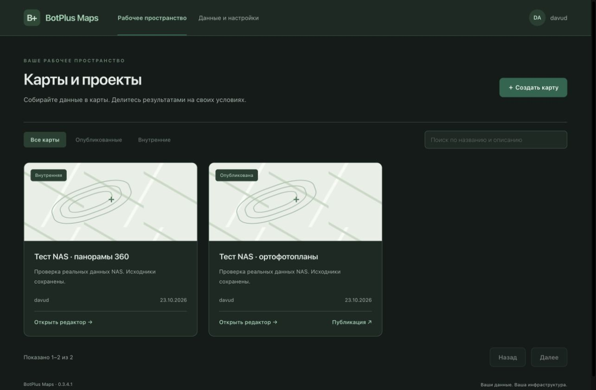

# BotPlus Maps

**Ваши карты. Ваши данные. Ваша инфраструктура.**

Открытая self-hosted геоплатформа для работы с ортофотопланами, панорамами, фотографиями и векторными слоями. Цель проекта — удобное картографическое рабочее пространство, которое можно развернуть на собственном сервере, хранить исходники на своих дисках и работать с ними через браузер.

[](LICENSE)
[](https://github.com/Davud77/botplus_maps/actions/workflows/checks.yml)

> **Статус: активная разработка. Обновлено 24 октября 2026.** Работают каталоги данных, фоновые задания, сохранённые карты и публикация растров, векторов и панорам. Целевой масштаб — терабайты растров и миллионы панорам; локальные синтетические проверки описаны отдельно и не заменяют комплексные нагрузочные испытания. Ограничения и дальнейшие работы — в [дорожной карте](ROADMAP.md) и [SECURITY.md](SECURITY.md).



*Главная страница работающего приложения, тёмная тема. Скриншот от 24 октября 2026.*

## Для чего

- Собственная геоплатформа для организации, муниципалитета, проектной команды или личного архива.
- Ортофотопланы размером в сотни гигабайт без скачивания исходного TIFF в браузер.
- Панорамы и фотографии, связанные с координатами и доступные на карте.
- Большие векторные наборы с фильтрацией и отображением по текущей области карты.
- Исходники и результаты в обычных папках локального диска или NAS; обязательного S3-сервиса нет.
- Загрузка небольших файлов через веб-интерфейс; подготовка и регистрация больших архивов локальными скриптами.
- Сохранение исходной системы координат и поддержка пользовательских CRS с проверяемым преобразованием координат.

По удобству работы ориентируемся на Felt и NextGIS: понятный интерфейс, управляемые слои, быстрый доступ к данным. Самостоятельное размещение и контроль над хранилищем — основные требования проекта.

## Что работает сейчас

| Возможность | Состояние |
| --- | --- |
| Карты и публикации | Создание, переименование, описание, удаление, сохранение конфигурации и отдельная опубликованная версия |
| Публичные панорамы | Покрытие, точки и просмотр 360° без входа; настройки слоя сохраняются, отключение публикации отзывает ссылку |
| Каталог панорам | Поиск, папки, теги, настройка полей и их порядка, страницы по 200 записей, отдельная корзина и восстановление |
| Панорамы на карте | Ограниченная выборка по видимой области, линии покрытия с контрастной обводкой, переход к точкам по клику; оформление и детализация настраиваются |
| Просмотр медиа | Фото / 360°, плавающее окно, разворачивание; загрузка изображения при выборе |
| Ортофотопланы | Страницы по 50 записей, автоматическое превью, переименование, смена проекции, видимость, скачивание и удаление |
| COG для браузера | Единая фоновая подготовка производной для быстрого показа; GDAL, TiTiler, WebP-тайлы и файловый кэш |
| Импорт с диска / NAS | Просмотр разрешённых папок, регистрация готового COG без копирования, пакетное подключение ортофото и импорт панорам |
| Задания и журналы | Общая FIFO-очередь, прогресс, отмена/повтор, журналы; завершённые задания скрываются кнопкой «Готово» |
| PostgreSQL / PostGIS | Векторные MVT, управление схемами и таблицами; базовый путь реализован, масштабирование продолжается |
| Пользовательские CRS | Общий реестр EPSG / WKT / PROJ; неизвестная CRS ортофото регистрируется, переименование отражается в связанных слоях |
| Подложки и оформление | OSM и WGS 84 по умолчанию для новых карт, собственные XYZ/TMS, светлая и тёмная темы |
| Управление слоями | Видимость, прозрачность, перетаскивание и настройки; порядок и оформление сохраняются в публикации |
| Пользователи и роли | Администратор / редактор / наблюдатель, смена пароля, отзыв сеансов и мастер первого запуска без стандартного пароля |
| Локальная CLI-подготовка растров | Метаданные, CRS, COG и манифесты; [инструкция](docs/LOCAL_IMPORT.md) |
| Проверки | Frontend-тесты, строгая сборка, unit- и интеграционные проверки на отдельной PostGIS-базе |

Публикация включается владельцем карты: сохраните карту и нажмите **«Опубликовать сохранённую карту»**. По ссылке доступны включённые в опубликованную конфигурацию слои; каталог и операции изменения требуют входа. При включении слоя панорам публикуется общий активный каталог панорам. Панорамы из корзины не выдаются, пути NAS и служебные ссылки хранения скрыты. Подробнее — [правила доступа](docs/WORKSPACE.md).

## Быстрый локальный запуск

Нужны Git, Python 3, Docker Engine с Compose v2 или Docker Desktop. Образы PostGIS и TiTiler в этом профиле используют `linux/amd64`; на Apple Silicon потребуется включённая эмуляция Docker Desktop. При первом запуске Docker скачивает образы и зависимости; полностью автономная установка пока не подготовлена.

```bash
git clone https://github.com/Davud77/botplus_maps.git
cd botplus_maps
python3 scripts/configure_local.py
docker compose --env-file .env.local -f compose.local.yml up --build -d
```

Откройте **[http://localhost:5580](http://localhost:5580)**. На пустой базе появится мастер: задайте логин администратора и пароль длиной 12–128 символов. После создания аккаунта откроется приложение. Стандартных аккаунтов `admin` / `user` больше нет. На существующей базе вход выполняется с прежними реквизитами; мастер не меняет пользователей.

Локальный конфиг содержит случайные секреты и создаётся с ограниченными правами доступа. Повторный запуск скрипта сохраняет существующий файл. Не публикуйте его.

```bash
# Состояние и журналы
docker compose --env-file .env.local -f compose.local.yml ps
docker compose --env-file .env.local -f compose.local.yml logs --tail=100 app

# Остановка с сохранением данных
docker compose --env-file .env.local -f compose.local.yml down
```

База и файловые каталоги сохраняются в именованных Docker-томах. MinIO не требуется. Публикуется только приложение, на loopback-интерфейсе компьютера; БД и TiTiler остаются во внутренней сети. Эта конфигурация предназначена для локальной работы. Для доступа по сети потребуются HTTPS, настройка cookies, резервное копирование и закрытие оставшихся вопросов безопасности. Не открывайте мастер незавершённой установки в общедоступный интернет: первый пользователь, завершивший настройку, становится администратором.

Основной `docker-compose.yml` сохранён для существующих установок; перед его использованием проверьте `.env.example` и параметры публикации портов.

Для подключения NAS и переноса прежних объектов MinIO см. [файловое хранилище](docs/FILESYSTEM_STORAGE.md). Существующую установку нужно сначала мигрировать; простая смена образа не переносит объекты.

## Большие данные: целевая схема

Браузер получает только нужное для текущего масштаба и области карты: растровые тайлы из COG, векторные MVT, покрытие панорам и ограниченная выборка точек. Выбранное фото или панорама пока загружается целиком; многомасштабные тайлы панорам ещё запланированы. Исходники остаются в хранилище. Индексация, преобразование CRS, построение уровней детализации и подготовка панорам выполняются фоновыми работниками.

Веб-загрузка и серверная регистрация файлов по разрешённым путям уже доступны. Возобновляемая загрузка и дальнейшее расширение CLI остаются в плане. Эти механизмы описаны в [архитектурном решении](docs/architecture/0001-self-host-data-and-ingestion.md). Сроки и критерии готовности — в [ROADMAP.md](ROADMAP.md).

Самостоятельное размещение не означает, что текущий интерфейс полностью работает без интернета: внешние подложки и другие сетевые зависимости ещё предстоит заменить или сделать настраиваемыми.

## Разработка и проверка

Фронтенд: React / TypeScript / Leaflet. Сервер: Flask / PostgreSQL / PostGIS / GDAL. Хранилище: обычные файлы на диске/NAS; каталог — PostgreSQL, векторы — PostGIS; растровые тайлы — TiTiler. По мере развития архитектуры компоненты будут меняться согласно ADR.

```bash
npm ci
npx tsc --noEmit
CI=true npm test -- --watchAll=false --runInBand
CI=true BROWSERSLIST_IGNORE_OLD_DATA=true npm run build
```

API в production-сборке использует текущий origin. Для разработки запустите backend на `127.0.0.1:5000` с зависимостями и переменными окружения, затем `npm start`: запросы `/api` идут через dev proxy. Для отдельного API можно задать `REACT_APP_API_BASE` при сборке.

Серверные unit- и интеграционные проверки описаны в [.github/workflows/checks.yml](.github/workflows/checks.yml). Интеграционные тесты требуют отдельную тестовую PostGIS-базу: не используйте рабочую базу данных.

## Документация

- [Панорамы: пространственный индекс, покрытие, настройки и публикация](docs/PANORAMA_PERFORMANCE.md)
- [Отображение ОФП: тайлы, кэш NAS и измерения скорости](docs/RASTER_PERFORMANCE.md)

- [Импорт без обработки, каталог панорам и системные журналы](docs/IMPORT_CATALOG.md)

- [Карты, роли и публичные ссылки](docs/WORKSPACE.md)
- [Профессиональный аудит и ограничения текущей версии](AUDIT_2026-10-20.md)
- [Дорожная карта, этапы и критерии приёмки](ROADMAP.md)
- [Подготовка растров и CRS через CLI](docs/LOCAL_IMPORT.md)
- [Хранение и импорт больших данных](docs/architecture/0001-self-host-data-and-ingestion.md)
- [Изоляция SQL-транзакций](docs/architecture/0002-isolated-database-transactions.md)
- [Безопасность и известные проблемы](SECURITY.md)

## Лицензия

BotPlus Maps распространяется по **GNU Affero General Public License v3.0 (AGPL-3.0)**. Полный текст — в [LICENSE](LICENSE).
